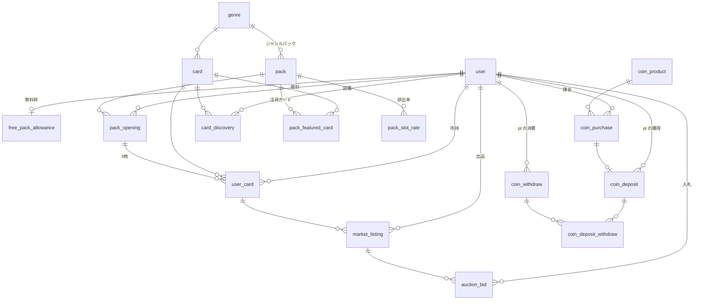

# DB 設計

> ステータス: 実装済み。スキーマは `packages/db/src/schema/`、マイグレーションは `packages/db/src/migrations/`。

[requirement.md](../requirement.md) の要件を Cloudflare D1（SQLite）と Drizzle ORM で実現するためのテーブル設計。
[database-pattern.md](../rules/database-pattern.md) に従い、どのテーブルも先頭に `id`・`createdAt`・`updatedAt` を置き、1テーブル1ファイルで定義する。
下の表では、この3列と、better-auth が管理する `user` などのテーブルは省略する。

## 全体像



テーブルは役割ごとに4つに分かれる。

- マスタ（運営が作る）: `genre`、`card`、`rarity_threshold`、`pack`、`pack_slot_rate`、`pack_featured_card`、`coin_product`
- 所持と開封: `user_card`、`card_discovery`、`pack_opening`、`free_pack_allowance`
- 通貨: `coin_deposit`、`coin_withdraw`、`coin_deposit_withdraw`、`coin_purchase`
- マーケット: `market_listing`、`auction_bid`

## enum

値は `packages/db/src/enums.ts` にまとめてある。

| enum                  | 値                                                                        | 使う列                                 |
| --------------------- | ------------------------------------------------------------------------- | -------------------------------------- |
| rarity                | `common` / `uncommon` / `rare` / `double_rare` / `legendary`              | `card.rarity`、`pack_slot_rate.rarity` |
| pack_type             | `free_basic` / `premium`                                                  | `pack.type`                            |
| pack_payment          | `free_initial` / `free_daily` / `coin`                                    | `pack_opening.payment`                 |
| user_card_status      | `owned` / `listed` / `redeemed`                                           | `user_card.status`                     |
| listing_format        | `fixed_price` / `auction`                                                 | `market_listing.format`                |
| listing_status        | `active` / `sold` / `cancelled` / `expired`                               | `market_listing.status`                |
| bid_status            | `leading` / `outbid` / `won`                                              | `auction_bid.status`                   |
| coin_deposit_source   | `purchase` / `card_redeem` / `market_sale` / `bid_refund` / `admin_grant` | `coin_deposit.source`                  |
| coin_withdraw_purpose | `pack_open` / `market_buy` / `auction_bid` / `admin_revoke`               | `coin_withdraw.purpose`                |
| purchase_provider     | `mock` / `stripe` / `app_store` / `google_play`                           | `coin_purchase.provider`               |
| purchase_status       | `pending` / `completed` / `failed` / `refunded`                           | `coin_purchase.status`                 |

SQLite には enum 型がないため、Drizzle の `text("...", { enum: [...] })` で TypeScript 側の型を絞り込む。

## マスタ

### genre

カードとジャンルパックの分類。

| 列             | 型          | 説明                              |
| -------------- | ----------- | --------------------------------- |
| slug           | text unique | URL 用。`history`、`space` など   |
| name           | text        | 表示名。「歴史」など              |
| sourceCategory | text        | 取り込み元の Wikipedia カテゴリ名 |
| colorHex       | text        | カード枠や開封演出の背景色        |
| sortOrder      | integer     | 一覧の並び順                      |

### card

Wikipedia の記事1ページに対応するカード。所持品ではなく、カードの種類を表す。

| 列                  | 型             | 説明                                                       |
| ------------------- | -------------- | ---------------------------------------------------------- |
| wikiLang            | text           | 言語版。`ja` など                                          |
| wikiPageId          | integer        | Wikipedia の page_id。改名されても変わらない               |
| title               | text           | 記事タイトル                                               |
| wikiRevisionId      | integer null   | 取り込んだ時点の版 ID。seed のサンプルカードは null        |
| wikiFetchedAt       | timestamp null | 記事を取り込んだ日時。seed のサンプルカードは seed の日時  |
| summary             | text           | 冒頭の要約。CC BY-SA 4.0                                   |
| imageUrl            | text null      | Wikimedia Commons のフリーライセンス画像だけを入れる       |
| imageCredit         | text null      | 画像の作者とライセンス表記                                 |
| genreId             | text → genre   | 属するジャンル。1枚につき1つ                               |
| rarity              | rarity         | 作成時に固定する                                           |
| monthlyPageviews    | integer        | レアリティ判定に使った月平均閲覧数                         |
| pageviewsMeasuredAt | timestamp      | 閲覧数を取った日時                                         |
| isActive            | boolean        | false にすると新しく排出されなくなる。所持済みのものは残る |

- `(wikiLang, wikiPageId)` に unique 制約をつける。同じ記事のカードを二重に作らない。
- `(genreId, rarity, isActive)` に index をつける。抽選でジャンルとレアリティから候補を引くため。
- 還元ポイントはレアリティから決まるので列に持たない。`packages/api/src/shared/card/get-redeem-points.ts` に置く。
- Wikipedia へのリンクは `https://{wikiLang}.wikipedia.org/wiki/{title}` で作る。改名されても Wikipedia 側のリダイレクトで記事にたどり着ける。
- 帰属表示として、取り込んだ時点の版へのリンク `https://{wikiLang}.wikipedia.org/w/index.php?oldid={wikiRevisionId}` をカード詳細に出す。要約はこの版の冒頭から取っている。

### rarity_threshold

レアリティごとの月間閲覧数の下限。言語版ごとに、コモン以外の4行を持つ。

| 列                  | 型      | 説明                                   |
| ------------------- | ------- | -------------------------------------- |
| wikiLang            | text    | 言語版                                 |
| rarity              | rarity  | `uncommon` 以上。コモンは下限がない    |
| minMonthlyPageviews | integer | このレアリティになる月平均閲覧数の下限 |

- `(wikiLang, rarity)` に unique 制約をつける。
- 最初の取り込みで、閲覧数の順位（上位 1%・5%・20%・50%）から決める。あとから足すカードも同じ下限で判定する。取り込むたびに順位で決め直すと、同じ閲覧数でも取り込んだ時期によってレアリティが変わってしまうため。
- 下限を変えても、すでにあるカードのレアリティは変わらない。
- 計算は `packages/db/src/rarity.ts` に置く。seed も同じ計算で下限を入れる。

### pack

開封できるパックの種類。

| 列                | 型                | 説明                                                  |
| ----------------- | ----------------- | ----------------------------------------------------- |
| slug              | text unique       | URL 用                                                |
| name              | text              | 「基本パック」「宇宙パック」など                      |
| description       | text              |                                                       |
| type              | pack_type         | `free_basic` は無料枠で開ける。`premium` は pt が必要 |
| genreId           | text null → genre | null なら全ジャンルから出る                           |
| priceCoins        | integer null      | `premium` のときの価格                                |
| cardsPerPack      | integer           | 5                                                     |
| imageUrl          | text null         | パックの絵柄。null なら colorHex から描く             |
| colorHex          | text              | パックの色                                            |
| startsAt / endsAt | timestamp null    | 販売期間。null なら無期限                             |
| isActive          | boolean           |                                                       |
| sortOrder         | integer           | カルーセルの並び順                                    |

### pack_slot_rate

パックの何枚目に、どのレアリティが、どの重みで出るか。排出率表示の元データでもある。

| 列     | 型          | 説明                                       |
| ------ | ----------- | ------------------------------------------ |
| packId | text → pack |                                            |
| slot   | integer     | 1〜5（何枚目か）                           |
| rarity | rarity      |                                            |
| weight | integer     | 重み。同じ枠の合計で割ったものが確率になる |

- `(packId, slot, rarity)` に unique 制約をつける。
- 確率を小数で持たず整数の重みで持つ。合計が100%にならない設定ミスを避け、表示時に計算するため。

初期値（重みは10000分率）。seed（`packages/db/src/seed/master-data.ts`）もこの値で作る。

| パック         | 枠   | コモン | アンコモン | レア | ダブルレア | レジェンド |
| -------------- | ---- | ------ | ---------- | ---- | ---------- | ---------- |
| 基本パック     | 1〜3 | 10000  | 0          | 0    | 0          | 0          |
| 基本パック     | 4    | 0      | 8900       | 900  | 160        | 40         |
| 基本パック     | 5    | 0      | 6000       | 3000 | 800        | 200        |
| ジャンルパック | 1〜3 | 10000  | 0          | 0    | 0          | 0          |
| ジャンルパック | 4    | 0      | 7000       | 2200 | 600        | 200        |
| ジャンルパック | 5    | 0      | 0          | 7000 | 2400       | 600        |

価格を決めるときは、1パックの還元ポイントの期待値が価格を下回るようにする。上回ると「買って還元する」だけで pt が増えてしまう。
初期値のジャンルパックの期待値は約 50pt で、価格 150pt を下回る。

### pack_featured_card

パックで出やすくしたいカード。ジャンルパックの「特定のカードがよく出る」を表す。

| 列     | 型          | 説明                                                                |
| ------ | ----------- | ------------------------------------------------------------------- |
| packId | text → pack |                                                                     |
| cardId | text → card |                                                                     |
| weight | integer     | 同じレアリティの候補のなかでの重み。登録のないカードは 1 として扱う |

- `(packId, cardId)` に unique 制約をつける。
- 抽選は2段階で行う。まず `pack_slot_rate` で枠ごとのレアリティを決め、次にそのレアリティの候補カードから `pack_featured_card.weight` の重みで1枚を選ぶ。
  - 全カードを `pack_featured_card` に並べなくて済む。候補はパックの `genreId` と `card.isActive` で絞り込んで作る。
  - 候補カードが1枚もないレアリティは抽選から外す。

### coin_product

ショップで売る pt の商品。

| 列          | 型          | 説明                                    |
| ----------- | ----------- | --------------------------------------- |
| sku         | text unique | 各ストアの商品 ID と対応させる          |
| name        | text        | 「1,000pt」など                         |
| priceAmount | integer     | 最小通貨単位。10ドルなら 1000（セント） |
| currency    | text        | `USD`、`JPY`                            |
| coins       | integer     | 付与する有償 pt                         |
| isActive    | boolean     |                                         |
| sortOrder   | integer     |                                         |

## 所持と開封

### pack_opening

パックを1回開けた記録。抽選結果はここに紐づく `user_card` として残る。

| 列         | 型             | 説明                                             |
| ---------- | -------------- | ------------------------------------------------ |
| userId     | text → user    |                                                  |
| packId     | text → pack    |                                                  |
| payment    | pack_payment   | 登録時の無料枠か、毎日の無料枠か、pt か          |
| coinsSpent | integer        | 無料なら 0                                       |
| revealedAt | timestamp null | 開封演出を最後まで見た（結果画面に到達した）日時 |

- 抽選は「これにする」を押した時点でサーバーが行い、結果を保存してから演出を始める。演出中にリロードしても引き直しにはならず、`revealedAt` が null の開封は開封履歴から演出を再開できる。
- `(userId, createdAt)` に index をつける。開封履歴を新しい順に出すため。

### free_pack_allowance

無料パックの残り枠。ユーザー1人につき1行。

| 列               | 型                 | 説明                                                  |
| ---------------- | ------------------ | ----------------------------------------------------- |
| userId           | text unique → user |                                                       |
| initialRemaining | integer            | 登録時の無料枠の残り。初期値 20。期限なし             |
| dailyUsedDate    | text null          | 毎日の無料枠を最後に使った日（日本時間の YYYY-MM-DD） |
| dailyUsedCount   | integer            | その日に使った毎日の無料枠の数                        |

- 無料枠は「登録時の 20 パック」と「日本時間の日ごとに 10 パック」の2つ。毎日の枠は貯まらない。3日開けなくても使えるのはその日の 10 パックだけ。
  - その日の残りは `dailyUsedDate` が今日なら `10 - dailyUsedCount`、今日でなければ 10。日付が変わったときに行を書き換える処理はいらない。
- 開けるときは毎日の枠を先に使い、なくなったら登録時の枠を使う。毎日の枠は持ち越せないので、先に使うほうが利用者に有利になる。
- 行は最初に無料パックを開けたときに作る。行がないユーザーは、登録時の枠 20、毎日の枠 10 が残っているとみなす。
- 枠を減らすときは「その日の数が 10 未満」「登録時の枠が 1 以上」を条件にした UPDATE を1文で実行する。同時に開封されても枠を超えない。

### user_card

ユーザーが持っている1枚1枚のカード。同じカードを3枚持っていれば3行ある。
マーケットに1枚単位で出品するため、枚数のカウンターではなく1枚ごとに行を持つ。

| 列             | 型                       | 説明                                                         |
| -------------- | ------------------------ | ------------------------------------------------------------ |
| userId         | text → user              | いまの持ち主。マーケットで売れたら買った人に書き換える       |
| cardId         | text → card              |                                                              |
| status         | user_card_status         | `owned` 所持中、`listed` 出品中、`redeemed` 還元済み         |
| packOpeningId  | text null → pack_opening | どの開封で出たか                                             |
| slot           | integer null             | 開封演出でめくる順番。抽選後にレアリティの低い順に並べてある |
| isNewOnAcquire | boolean                  | 手に入れた時点で初めてのカードだったか。NEW バッジに使う     |
| redeemedAt     | timestamp null           |                                                              |

- `(userId, status, cardId)` に index をつける。コレクション画面で所持中のカードをまとめて数えるため。
- 還元しても行は消さず `status = redeemed` にする。開封履歴から追えるようにするため。
- `listed` のカードは還元も別の出品もできない。
- 同じパックで同じカードが2枚出たときは、1枚目だけを NEW にする。

### card_discovery

ユーザーが一度でも手に入れたカード。図鑑（コンプリート率）と NEW 判定に使う。

| 列              | 型          | 説明 |
| --------------- | ----------- | ---- |
| userId          | text → user |      |
| cardId          | text → card |      |
| firstAcquiredAt | timestamp   |      |

- `(userId, cardId)` に unique 制約をつける。
- 還元や売却で手放しても消さない。図鑑は「出会ったことがあるか」で埋まる。
- 図鑑で見つけていないカードは、カード詳細を開けない。

## 通貨

pt の残高を1つの数値として持つテーブルは作らない。
獲得（`coin_deposit`）と、消費をどの獲得分から払ったか（`coin_deposit_withdraw`）を記録し、残高はその差として求める。

```txt
残高 = coin_deposit.amount の合計 − coin_deposit_withdraw.amount の合計
獲得1件の残り = その coin_deposit.amount − その獲得に割り当てた coin_deposit_withdraw.amount の合計
```

- 獲得1件ごとに有償か無償かを持つので、残高を有償・無償に分けて出せる。資金決済法で有償分の未使用残高を報告・保全するのに使う。
- どの獲得分を消費したかが残るので、獲得ごとに有効期限を設けたくなったときも、期限切れの分だけを除いて計算できる。
- 記録は追記のみで、更新・削除はしない。

### coin_deposit

pt を獲得した記録。

| 列              | 型                  | 説明                                                 |
| --------------- | ------------------- | ---------------------------------------------------- |
| userId          | text → user         |                                                      |
| source          | coin_deposit_source | 購入、還元、売上、入札の返金、運営からの付与         |
| isPaid          | boolean             | 課金で得た有償 pt なら true。それ以外は無償          |
| amount          | integer             | 獲得した pt                                          |
| coinPurchaseId  | text null           | 獲得の理由に応じて関連するものを入れる               |
| userCardId      | text null           | 1枚を還元したときのカード                            |
| marketListingId | text null           | 売上のときの出品                                     |
| auctionBidId    | text null           | 入札の返金のときの入札                               |
| note            | text null           | まとめて還元したときの枚数、運営による付与の理由など |

- `(userId, createdAt)` に index をつける。
- 重複をまとめて還元したときは、獲得を1件にまとめる。1pt の獲得が細かく大量にできると、消費のたびに割り当てが散らばるため。

### coin_withdraw

pt を消費した記録。

| 列              | 型                    | 説明                                       |
| --------------- | --------------------- | ------------------------------------------ |
| userId          | text → user           |                                            |
| userSequence    | integer               | ユーザーごとの消費の通し番号。1 から始まる |
| purpose         | coin_withdraw_purpose | パックの開封、マーケットでの購入、入札など |
| amount          | integer               | 消費した pt                                |
| packOpeningId   | text null             | 消費の目的に応じて関連するものを入れる     |
| marketListingId | text null             |                                            |
| auctionBidId    | text null             |                                            |
| note            | text null             |                                            |

- `(userId, userSequence)` に unique 制約をつける。同じユーザーが同時に2回消費しようとしたとき、後から書いた方が制約違反になり、その batch ごと取り消される。残高を超えて消費されるのを防ぐため。
  - 消費の直前に残高と「最後の通し番号」を読み、通し番号 +1 で書く。

### coin_deposit_withdraw

1回の消費を、どの獲得分からいくら払ったかに割り当てる。

| 列         | 型                   | 説明                    |
| ---------- | -------------------- | ----------------------- |
| depositId  | text → coin_deposit  |                         |
| withdrawId | text → coin_withdraw |                         |
| amount     | integer              | この獲得分から払った pt |

- `(depositId, withdrawId)` に unique 制約、`withdrawId` に index をつける。
- 割り当ては無償 pt から先に、同じ種類なら古い獲得分から順に行う。利用規約と資金決済法に基づく表示にもこの順番を書いている。
- 1回の消費の割り当ての合計は、`coin_withdraw.amount` と一致する。

### coin_purchase

課金の記録。

| 列                       | 型                  | 説明                                                       |
| ------------------------ | ------------------- | ---------------------------------------------------------- |
| userId                   | text → user         |                                                            |
| coinProductId            | text → coin_product |                                                            |
| provider                 | purchase_provider   | `mock` はローカル開発用の支払いなしの購入                  |
| providerPaymentId        | text                | Stripe の Checkout Session ID、ストアのトランザクション ID |
| amount / currency        | integer / text      | 実際に払われた額。商品の価格改定に影響されないよう複製する |
| coins                    | integer             | 付与した pt                                                |
| status                   | purchase_status     |                                                            |
| completedAt / refundedAt | timestamp null      |                                                            |

- `(provider, providerPaymentId)` に unique 制約をつける。Webhook が二重に届いても pt を二重に付与しないため。
- 購入が完了したら、`isPaid = true` の `coin_deposit` を作る。
- 決済サービスとの連携（Stripe Checkout と Webhook）は未実装。いまはローカル開発（`PAYMENT_MODE=mock`）でだけ、支払いなしで購入を完了できる。

## マーケット

### market_listing

カード1枚の出品。フリマとオークションを1つのテーブルで持ち、形式ごとに使う列が変わる。

| 列           | 型               | 説明                           |
| ------------ | ---------------- | ------------------------------ |
| sellerId     | text → user      |                                |
| userCardId   | text → user_card | 出品しているカード             |
| cardId       | text → card      | 検索用に複製する               |
| format       | listing_format   |                                |
| status       | listing_status   |                                |
| price        | integer null     | フリマの価格                   |
| startPrice   | integer null     | オークションの開始価格         |
| currentPrice | integer null     | オークションのいまの最高入札額 |
| bidCount     | integer          |                                |
| endsAt       | timestamp null   | オークションの終了日時         |
| buyerId      | text null → user | 成立したときの買い手           |
| soldPrice    | integer null     | 成立価格                       |
| feeAmount    | integer null     | 手数料（成立価格の 10%）       |
| soldAt       | timestamp null   |                                |

- `userCardId` に `status = 'active'` の部分 unique index をつける。同じカードを二重に出品させないため。
- `(status, format, cardId)`、`(status, endsAt)`、`(sellerId, createdAt)` に index をつける。
- 出品すると `user_card.status = listed` にし、取り下げや期限切れで `owned` に戻す。
- 売れたら `user_card.userId` を買い手に書き換えて `owned` に戻し、買い手に `card_discovery` を足す。
- 入札のあるオークションは取り下げられない。

### auction_bid

オークションへの入札。

| 列        | 型                    | 説明                                            |
| --------- | --------------------- | ----------------------------------------------- |
| listingId | text → market_listing |                                                 |
| bidderId  | text → user           |                                                 |
| sequence  | integer               | 出品ごとの入札の通し番号。1 から始まる          |
| amount    | integer               |                                                 |
| status    | bid_status            | `leading` 最高額、`outbid` 抜かれた、`won` 落札 |

- `(listingId, sequence)` に unique 制約をつける。同時に入札されたとき、後から書いた方の batch を失敗させる。
- 入札すると、その額をその場で消費する（`coin_withdraw` の `auction_bid`）。抜かれたら、払ったときと同じ有償・無償の内訳で `coin_deposit`（`bid_refund`）を作って返す。落札したら返さない。
  - 落札時に残高が足りない、という状態を起こさないため。
- 出品者と、いま最高額の入札者は入札できない。
- 次の入札額は、入札がなければ開始価格、あれば `currentPrice` に 5%（最低 1pt）を足した額以上とする。

## 整合性を守る処理

D1 はアプリから任意のトランザクションを張れないため、次の方針をとる。

- 複数の書き込みは Drizzle の `db.batch()` でまとめる。batch は1つのトランザクションとして実行され、途中で失敗するとすべて取り消される。
- 同時に起きると困る書き込みは、通し番号の unique 制約（`coin_withdraw.userSequence`、`auction_bid.sequence`）か、条件付き UPDATE（`status = 'active'` のときだけ更新、など）で1件だけを通す。
- 同じ batch で作った行を別の行から参照するときは、id を手で作らず、unique な列で引くサブクエリを値にする（例: `(select id from coin_withdraw where user_id = ? and user_sequence = ?)`）。
- D1 は1文あたりのバインド変数が 100 個までなので、多くの行を書くときは文を分ける。
- 終了したオークションの締めは、マーケットの一覧・詳細・取引の管理を開いたときに行う。Cron Trigger での定期実行は未実装。

### パック開封

1. 有料パックは残高を確かめる。
2. 抽選: `pack_slot_rate` と `pack_featured_card` からサーバーで5枚を決め、レアリティの低い順に並べる。乱数は `crypto.getRandomValues` を使う。
3. 無料パックは `free_pack_allowance` を条件付き UPDATE で減らす。
4. `pack_opening` を作る。
5. batch で `user_card` 5行、`card_discovery`（新規分）、有料なら `coin_withdraw` と `coin_deposit_withdraw` を書く。
6. batch が失敗したら、`pack_opening` を消し、無料枠を戻す。

### ポイント還元

1. `user_card` を `status = 'owned'` かつ持ち主が本人の条件で `redeemed` に更新する。更新できなければ還元できない。
2. 無償の `coin_deposit`（`card_redeem`）を作る。

### フリマ購入

1. 買い手の残高を確かめる。
2. `market_listing` を `status = 'active'` の条件で `sold` に更新する。更新できなければ売り切れ。
3. batch で買い手の `coin_withdraw`（`market_buy`）と割り当て、出品者の無償 `coin_deposit`（`market_sale`、価格 − 手数料）、`user_card` の持ち主の変更、買い手の `card_discovery` を書く。
4. batch が失敗したら出品を `active` に戻す。

### オークションの入札

1. 出品が受付中か、入札額が最低額以上か、自分が出品者や最高額の入札者でないかを確かめる。
2. batch で、前の最高額の入札を `outbid` にしてその人に返金し、新しい入札（通し番号 = これまでの入札数 + 1）、入札者の `coin_withdraw` と割り当て、`market_listing` の現在価格と入札数を書く。

### オークションの締め

1. 終了時刻を過ぎた `active` のオークションを探す。
2. 入札がなければ `expired` にし、カードを `owned` に戻す。
3. 入札があれば `sold` にし、batch で入札を `won` に、カードを落札者に移し、出品者に無償 `coin_deposit`（`market_sale`）を作る。落札者の pt は入札時に消費済み。

## Wikipedia からのカード作成

`packages/wiki-import` で行う。いまはローカルから `bun run wiki:import` で実行し、ローカルの D1 に書く。本番の D1 への取り込みは未実装。

1. ジャンルの `sourceCategory` から記事を集める（MediaWiki Action API の `list=categorymembers`）。サブカテゴリは `--depth` 段までたどる。すでにカードになっている記事は取り直さない。
2. 記事のカテゴリ、曖昧さ回避かどうか、代表画像のファイル名を 50 件ずつまとめて取る（`prop=categories|pageimages|pageprops`）。ここで除外の条件に当たる記事を外す。
3. 代表画像のライセンスを確かめる（`prop=imageinfo` の `extmetadata`）。Commons にある画像で、CC BY・CC BY-SA・CC0・パブリックドメインのものだけを使う。CC BY 系で作者がわからない画像は使わない。使えない画像のカードは、ジャンルの色とタイトルの1文字目で絵柄を描く。
4. 記事ごとに要約と版 ID を取る（REST API の `/page/summary/{title}`）。要約は `extract` をそのまま使う。
5. 直近12か月（今月を除く）の閲覧数を取る（Wikimedia Pageviews API の `per-article`、`agent=user`）。閲覧のない月も数え、合計を12で割る。
6. `rarity_threshold` の下限でレアリティを決め、`card` に保存する。下限がまだなければ、いまあるカードとこの取り込みの記事の閲覧数の順位から決め、カードと同じ batch で保存する。

除外の条件（`packages/wiki-import/src/get-exclusion-reason.ts`）は次のとおり。人の確認ははさまない。外し漏れたカードは `isActive` を false にして止める。

- 曖昧さ回避のページ
- タイトルに「一覧」を含む記事
- 事件・事故・テロ・殺人・災害を名前に含むカテゴリに入っている記事
- 要約が30文字に満たない記事

API の呼び方は次のとおり。

- User-Agent に、アプリ名と連絡先としてリポジトリの URL を入れる（`wiki-collection/0.1 (+https://github.com/matsupiee/wiki-collection)`）。Wikimedia の User-Agent ポリシーに従うため。
- 同時に投げるリクエストは3本までにする。Action API には `maxlag=5` を付ける。
- 429、5xx、maxlag のエラーは、`Retry-After` の秒数か、1秒から倍々に待って4回まで再試行する。
