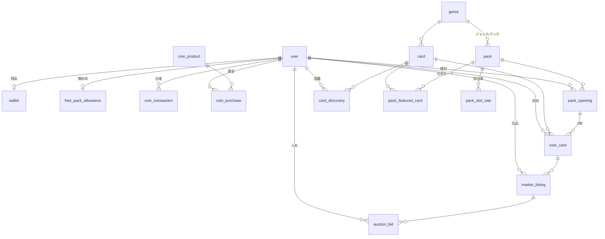

# DB 設計

> ステータス: 設計案。マイグレーションは未作成。

[requirement.md](../requirement.md) の要件を Cloudflare D1（SQLite）と Drizzle ORM で実現するためのテーブル設計。
[database-pattern.md](../rules/database-pattern.md) に従い、どのテーブルも先頭に `id`・`createdAt`・`updatedAt` を置き、1テーブル1ファイルで `packages/db/src/schema/` に定義する。
下の表では、この3列と、better-auth が管理する `user` などのテーブルは省略する。

## 全体像

テーブルは役割ごとに4つに分かれる。

- マスタ（運営が作る）: `genre`、`card`、`pack`、`pack_slot_rate`、`pack_featured_card`、`coin_product`
- 所持と開封: `user_card`、`card_discovery`、`pack_opening`、`free_pack_allowance`
- 通貨: `wallet`、`coin_transaction`、`coin_purchase`
- マーケット: `market_listing`、`auction_bid`

## enum

| enum              | 値                                                                                                                               | 使う列                                 |
| ----------------- | -------------------------------------------------------------------------------------------------------------------------------- | -------------------------------------- |
| rarity            | `common` / `uncommon` / `rare` / `double_rare` / `legendary`                                                                     | `card.rarity`、`pack_slot_rate.rarity` |
| pack_type         | `free_basic` / `premium`                                                                                                         | `pack.type`                            |
| pack_payment      | `free_initial` / `free_daily` / `coin`                                                                                           | `pack_opening.payment`                 |
| user_card_status  | `owned` / `listed` / `redeemed`                                                                                                  | `user_card.status`                     |
| listing_format    | `fixed_price` / `auction`                                                                                                        | `market_listing.format`                |
| listing_status    | `active` / `sold` / `cancelled` / `expired`                                                                                      | `market_listing.status`                |
| bid_status        | `leading` / `outbid` / `won` / `cancelled`                                                                                       | `auction_bid.status`                   |
| coin_tx_type      | `purchase` / `pack_open` / `card_redeem` / `market_buy` / `market_sale` / `bid_hold` / `bid_release` / `refund` / `admin_adjust` | `coin_transaction.type`                |
| purchase_provider | `stripe` / `app_store` / `google_play`                                                                                           | `coin_purchase.provider`               |
| purchase_status   | `pending` / `completed` / `failed` / `refunded`                                                                                  | `coin_purchase.status`                 |

SQLite には enum 型がないため、Drizzle の `text("...", { enum: [...] })` で TypeScript 側の型を絞り込む。

## マスタ

### genre

カードとジャンルパックの分類。

| 列             | 型          | 説明                              |
| -------------- | ----------- | --------------------------------- |
| slug           | text unique | URL 用。`history`、`space` など   |
| name           | text        | 表示名。「歴史」など              |
| sourceCategory | text        | 取り込み元の Wikipedia カテゴリ名 |
| colorHex       | text        | カード枠や開封演出の背景色        |
| sortOrder      | integer     | 一覧の並び順                      |

### card

Wikipedia の記事1ページに対応するカード。所持品ではなく、カードの種類を表す。

| 列                  | 型           | 説明                                                       |
| ------------------- | ------------ | ---------------------------------------------------------- |
| wikiLang            | text         | 言語版。`ja` など                                          |
| wikiPageId          | integer      | Wikipedia の page_id。改名されても変わらない               |
| title               | text         | 記事タイトル                                               |
| summary             | text         | 冒頭の要約。CC BY-SA 4.0                                   |
| imageUrl            | text null    | Wikimedia Commons のフリーライセンス画像だけを入れる       |
| imageCredit         | text null    | 画像の作者とライセンス表記                                 |
| genreId             | text → genre | 属するジャンル。1枚につき1つ                               |
| rarity              | rarity       | 作成時に固定する                                           |
| monthlyPageviews    | integer      | レアリティ判定に使った月平均閲覧数                         |
| pageviewsMeasuredAt | timestamp    | 閲覧数を取った日時                                         |
| isActive            | boolean      | false にすると新しく排出されなくなる。所持済みのものは残る |

- `(wikiLang, wikiPageId)` に unique 制約をつける。同じ記事のカードを二重に作らない。
- `(genreId, rarity, isActive)` に index をつける。抽選でジャンルとレアリティから候補を引くため。
- 還元ポイントはレアリティから決まるので列に持たない。`packages/api/src/shared/card/get-redeem-points.ts` に置く。

### pack

開封できるパックの種類。

| 列                | 型                | 説明                                                  |
| ----------------- | ----------------- | ----------------------------------------------------- |
| slug              | text unique       | URL 用                                                |
| name              | text              | 「基本パック」「宇宙パック」など                      |
| description       | text              |                                                       |
| type              | pack_type         | `free_basic` は無料枠で開ける。`premium` は pt が必要 |
| genreId           | text null → genre | null なら全ジャンルから出る                           |
| priceCoins        | integer null      | `premium` のときの価格                                |
| cardsPerPack      | integer           | 5                                                     |
| imageUrl          | text              | パックの絵柄                                          |
| startsAt / endsAt | timestamp null    | 販売期間。null なら無期限                             |
| isActive          | boolean           |                                                       |
| sortOrder         | integer           | カルーセルの並び順                                    |

### pack_slot_rate

パックの何枚目に、どのレアリティが、どの重みで出るか。排出率表示の元データでもある。

| 列     | 型          | 説明                                       |
| ------ | ----------- | ------------------------------------------ |
| packId | text → pack |                                            |
| slot   | integer     | 1〜5（何枚目か）                           |
| rarity | rarity      |                                            |
| weight | integer     | 重み。同じ枠の合計で割ったものが確率になる |

- `(packId, slot, rarity)` に unique 制約をつける。
- 確率を小数で持たず整数の重みで持つ。合計が100%にならない設定ミスを避け、表示時に計算するため。

初期値の例（重みは10000分率）。

| パック         | 枠   | コモン | アンコモン | レア | ダブルレア | レジェンド |
| -------------- | ---- | ------ | ---------- | ---- | ---------- | ---------- |
| 基本パック     | 1〜3 | 10000  | 0          | 0    | 0          | 0          |
| 基本パック     | 4    | 0      | 8900       | 900  | 160        | 40         |
| 基本パック     | 5    | 0      | 6000       | 3000 | 800        | 200        |
| ジャンルパック | 1〜3 | 10000  | 0          | 0    | 0          | 0          |
| ジャンルパック | 4    | 0      | 7000       | 2200 | 600        | 200        |
| ジャンルパック | 5    | 0      | 0          | 7000 | 2400       | 600        |

価格を決めるときは、1パックの還元ポイントの期待値が価格を下回るようにする。上回ると「買って還元する」だけで pt が増えてしまう。

### pack_featured_card

パックで出やすくしたいカード。ジャンルパックの「特定のカードがよく出る」を表す。

| 列     | 型          | 説明                                                                |
| ------ | ----------- | ------------------------------------------------------------------- |
| packId | text → pack |                                                                     |
| cardId | text → card |                                                                     |
| weight | integer     | 同じレアリティの候補のなかでの重み。登録のないカードは 1 として扱う |

- `(packId, cardId)` に unique 制約をつける。
- 抽選は2段階で行う。まず `pack_slot_rate` で枠ごとのレアリティを決め、次にそのレアリティの候補カードから `pack_featured_card.weight` の重みで1枚を選ぶ。
  - 全カードを `pack_featured_card` に並べなくて済む。候補はパックの `genreId` と `card.isActive` で絞り込んで作る。

### coin_product

ショップで売る pt の商品。

| 列          | 型          | 説明                                    |
| ----------- | ----------- | --------------------------------------- |
| sku         | text unique | 各ストアの商品 ID と対応させる          |
| name        | text        | 「1000pt」など                          |
| priceAmount | integer     | 最小通貨単位。10ドルなら 1000（セント） |
| currency    | text        | `USD`、`JPY`                            |
| coins       | integer     | 付与する有償 pt                         |
| isActive    | boolean     |                                         |
| sortOrder   | integer     |                                         |

## 所持と開封

### pack_opening

パックを1回開けた記録。抽選結果はここに紐づく `user_card` として残る。

| 列         | 型             | 説明                                             |
| ---------- | -------------- | ------------------------------------------------ |
| userId     | text → user    |                                                  |
| packId     | text → pack    |                                                  |
| payment    | pack_payment   | 無料枠（初回・12時間）か pt か                   |
| coinsSpent | integer        | 無料なら 0                                       |
| revealedAt | timestamp null | 開封演出を最後まで見た（結果画面に到達した）日時 |

- 抽選は「これにする」を押した時点でサーバーが行い、結果を保存してから演出を始める。演出中にリロードしても引き直しにはならず、`revealedAt` が null の開封を見つけたら演出を再開する。
- `(userId, createdAt)` に index をつける。開封履歴を新しい順に出すため。

### free_pack_allowance

無料パックの残り枠。ユーザー1人につき1行。

| 列                   | 型                 | 説明                               |
| -------------------- | ------------------ | ---------------------------------- |
| userId               | text unique → user |                                    |
| initialRemaining     | integer            | 登録時の無料枠の残り。初期値 20    |
| nextDailyAvailableAt | timestamp          | 12時間枠が次に使えるようになる日時 |

- 登録時に `initialRemaining = 20`、`nextDailyAvailableAt = 登録日時` で作る。
- 無料パックを開けるときは、12時間枠が使えるなら先に使い、`nextDailyAvailableAt = 現在 + 12時間` にする。使えなければ `initialRemaining` を1減らす。
  - 初回枠を使っている間にも12時間枠を無駄にしないため、12時間枠を優先する。
- 枠を貯められるようにする場合は、`nextDailyAvailableAt` の代わりに「貯まっている回数」と「最後に回数を計算した日時」を持つ形に変える（[requirement.md](../requirement.md) の未確定の点）。

### user_card

ユーザーが持っている1枚1枚のカード。同じカードを3枚持っていれば3行ある。
マーケットに1枚単位で出品するため、枚数のカウンターではなく1枚ごとに行を持つ。

| 列             | 型                       | 説明                                                     |
| -------------- | ------------------------ | -------------------------------------------------------- |
| userId         | text → user              | いまの持ち主。マーケットで売れたら買った人に書き換える   |
| cardId         | text → card              |                                                          |
| status         | user_card_status         | `owned` 所持中、`listed` 出品中、`redeemed` 還元済み     |
| packOpeningId  | text null → pack_opening | どの開封で出たか                                         |
| slot           | integer null             | 開封の何枚目だったか。演出でめくる順番                   |
| isNewOnAcquire | boolean                  | 手に入れた時点で初めてのカードだったか。NEW バッジに使う |
| redeemedAt     | timestamp null           |                                                          |

- `(userId, status, cardId)` に index をつける。コレクション画面で所持中のカードをまとめて数えるため。
- 還元しても行は消さず `status = redeemed` にする。開封履歴と台帳から追えるようにするため。
- `listed` のカードは還元も別の出品もできない。

### card_discovery

ユーザーが一度でも手に入れたカード。図鑑（コンプリート率）と NEW 判定に使う。

| 列              | 型          | 説明 |
| --------------- | ----------- | ---- |
| userId          | text → user |      |
| cardId          | text → card |      |
| firstAcquiredAt | timestamp   |      |

- `(userId, cardId)` に unique 制約をつける。
- 還元や売却で手放しても消さない。図鑑は「出会ったことがあるか」で埋まる。

## 通貨

### wallet

ユーザーの pt 残高。ユーザー1人につき1行。

| 列          | 型                 | 説明                                          |
| ----------- | ------------------ | --------------------------------------------- |
| userId      | text unique → user |                                               |
| paidBalance | integer            | 課金で得た有償 pt                             |
| freeBalance | integer            | 還元・売上などで得た無償 pt                   |
| heldBalance | integer            | オークションの入札で押さえている pt。使えない |

- 有償と無償を分けるのは、資金決済法で有償分の未使用残高を報告・供託する必要があるため。
- 支払いは無償 pt から先に使う（どちらを先に使うかは利用規約に書く）。
- 残高を減らすときは `UPDATE wallet SET ... WHERE user_id = ? AND free_balance + paid_balance >= ?` のように条件付きで更新し、更新件数が 0 なら残高不足として扱う。残高をマイナスにしないため。

### coin_transaction

pt の増減をすべて残す台帳。追記のみで、更新・削除はしない。

| 列                                  | 型           | 説明                                |
| ----------------------------------- | ------------ | ----------------------------------- |
| userId                              | text → user  |                                     |
| type                                | coin_tx_type |                                     |
| paidDelta                           | integer      | 有償 pt の増減                      |
| freeDelta                           | integer      | 無償 pt の増減                      |
| heldDelta                           | integer      | 押さえ分の増減                      |
| paidBalanceAfter / freeBalanceAfter | integer      | 増減後の残高。調査用                |
| packOpeningId                       | text null    | 種類に応じて関連するものを1つ入れる |
| userCardId                          | text null    |                                     |
| marketListingId                     | text null    |                                     |
| coinPurchaseId                      | text null    |                                     |
| note                                | text null    | 運営による調整の理由など            |

- `(userId, createdAt)` に index をつける。履歴画面用。
- `wallet` の値は、この台帳を合計した値と常に一致させる。

### coin_purchase

課金の記録。決済サービスの Webhook を受けて作る。

| 列                       | 型                  | 説明                                                       |
| ------------------------ | ------------------- | ---------------------------------------------------------- |
| userId                   | text → user         |                                                            |
| coinProductId            | text → coin_product |                                                            |
| provider                 | purchase_provider   |                                                            |
| providerPaymentId        | text                | Stripe の Checkout Session ID、ストアのトランザクション ID |
| amount / currency        | integer / text      | 実際に払われた額。商品の価格改定に影響されないよう複製する |
| coins                    | integer             | 付与した pt                                                |
| status                   | purchase_status     |                                                            |
| completedAt / refundedAt | timestamp null      |                                                            |

- `(provider, providerPaymentId)` に unique 制約をつける。Webhook が二重に届いても pt を二重に付与しないため。

## マーケット

### market_listing

カード1枚の出品。フリマとオークションを1つのテーブルで持ち、形式ごとに使う列が変わる。

| 列           | 型               | 説明                                                          |
| ------------ | ---------------- | ------------------------------------------------------------- |
| sellerId     | text → user      |                                                               |
| userCardId   | text → user_card | 出品しているカード                                            |
| cardId       | text → card      | 検索用に複製する                                              |
| format       | listing_format   |                                                               |
| status       | listing_status   |                                                               |
| price        | integer null     | フリマの価格                                                  |
| startPrice   | integer null     | オークションの開始価格                                        |
| currentPrice | integer null     | オークションのいまの最高入札額                                |
| bidCount     | integer          |                                                               |
| endsAt       | timestamp null   | オークションの終了日時。フリマは null（期限なし）か任意の期限 |
| buyerId      | text null → user | 成立したときの買い手                                          |
| soldPrice    | integer null     | 成立価格                                                      |
| feeAmount    | integer null     | 手数料                                                        |
| soldAt       | timestamp null   |                                                               |

- `userCardId` に `status = 'active'` の部分 unique index をつける。同じカードを二重に出品させないため。
- `(status, format, cardId)` と `(status, endsAt)` に index をつける。マーケットの検索と、終了したオークションの締め処理のため。
- 出品すると `user_card.status = listed` にし、取り下げや期限切れで `owned` に戻す。
- 売れたら `user_card.userId` を買い手に書き換えて `owned` に戻し、買い手に `card_discovery` を足す。

### auction_bid

オークションへの入札。

| 列        | 型                    | 説明                                                                  |
| --------- | --------------------- | --------------------------------------------------------------------- |
| listingId | text → market_listing |                                                                       |
| bidderId  | text → user           |                                                                       |
| amount    | integer               |                                                                       |
| status    | bid_status            | `leading` 最高額、`outbid` 抜かれた、`won` 落札、`cancelled` 取り消し |

- 入札すると、その額を入札者の `wallet` から `heldBalance` に移す。抜かれたら元に戻す。落札したら押さえ分から支払う。
  - 落札時に残高が足りない、という状態を起こさないため。
- 出品者は自分の出品に入札できない。
- 次の入札額は `currentPrice` に最小上げ幅（例: 5%、最低1pt）を足した額以上とする。

## 整合性を守る処理

D1 はアプリから任意のトランザクションを張れないため、次の方針をとる。

- 複数の書き込みは Drizzle の `db.batch()` でまとめる。batch は1つのトランザクションとして実行され、途中で失敗するとすべて取り消される。
- 残高や枠を減らす処理は、条件付き UPDATE を先に1文で実行し、更新件数を見てから残りを batch で書く。
- 同じオークションへの同時入札は、オークションごとの Durable Object で順番に処理する。
- 終了したオークションの締め処理は Cron Trigger（1分ごと）で行い、画面を開いたときにも期限切れを判定する。

### パック開封

1. 支払い: 無料枠なら `free_pack_allowance`、有料なら `wallet` を条件付き UPDATE で減らす。
2. 抽選: `pack_slot_rate` と `pack_featured_card` からサーバーで5枚を決める。乱数は `crypto.getRandomValues` を使う。
3. batch で `pack_opening`、`user_card` 5行、`card_discovery`（新規分）、`coin_transaction`（有料のとき）を書く。
4. 演出用に5枚の内容と NEW かどうかを返す。

### ポイント還元

1. `user_card` を `status = 'owned'` かつ持ち主が本人の条件で `redeemed` に更新する。
2. batch で `wallet.freeBalance` を増やし、`coin_transaction`（`card_redeem`）を書く。

### フリマ購入

1. `market_listing` を `status = 'active'` の条件で `sold` に更新する。更新件数 0 なら売り切れ。
2. 買い手の `wallet` を条件付き UPDATE で減らす。足りなければ出品を `active` に戻す。
3. batch で出品者の `freeBalance` に（価格 − 手数料）を足し、`user_card` の持ち主を変え、`card_discovery` と `coin_transaction` 2行（`market_buy`、`market_sale`）を書く。

## Wikipedia からのカード作成

管理画面または定期バッチで行う。

1. 対象のカテゴリから記事を集める（MediaWiki Action API の `list=categorymembers`）。
2. 記事ごとに要約と画像を取る（REST API の `/page/summary/{title}`）。画像は Commons にあり、フリーライセンスのものだけを使う。
3. 直近12か月の閲覧数を取る（Wikimedia Pageviews API の `per-article`）。
4. カード全体のなかでの順位からレアリティを決めて `card` に保存する。

API を呼ぶときは、Wikimedia の User-Agent ポリシーに従い、連絡先を含む User-Agent を付ける。
