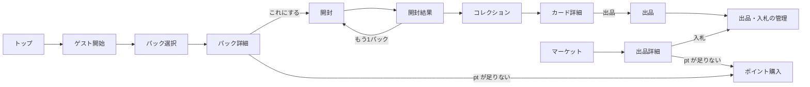

# 画面設計

> ステータス: 主要な画面はネイティブアプリに実装済み。ゲーム画面は `apps/native/app/`、規約ページだけを `apps/web/src/routes/legal/` に残す。

[requirement.md](../requirement.md) の要件を、スマートフォンの縦画面を基準にしたネイティブアプリ（Expo / React Native）の画面設計。パスはアプリ内の画面を表し、規約ページはアプリ内ブラウザでWebを開く。
PC では本文とヘッダー・ボトムタブの中身を中央の最大 28rem 幅に置き、ヘッダーとボトムタブの白背景は画面幅いっぱいに広げる。本文の左右は背景で埋める。
ヘッダーの下には最低 16px の余白を置く。選択中のボトムタブはアイコンと文字を青くし、薄い青の背景を付ける。検索条件を変えたり配下の画面へ移動したりしても、対応するタブの選択を保つ。

## 全体の構成

画面下のタブで5つの領域を切り替える。タブは本文のコンテナの外で画面下端に固定し、長い一覧をスクロールしても操作できる。本文の末尾にはタブとセーフエリアの高さ分の余白を確保する。開封演出中はタブとこの余白を外す。ヘッダーには常に pt 残高を出し、押すとポイント購入へ進む。その右のベルを押すと通知一覧が開く。未読があればベルの右上に赤い点を表示する。

| タブ         | 主な画面                             |
| ------------ | ------------------------------------ |
| パック       | パック選択、パック詳細、開封         |
| コレクション | 所持カード一覧、カード詳細           |
| ランキング   | 自分の順位、上位50人のカード資産     |
| マーケット   | オークション、出品           |
| マイページ   | 通知、取引、残高履歴、開封履歴、規約 |



## 画面一覧

| 画面             | パス                              | ログイン | 内容                                                                             |
| ---------------- | --------------------------------- | -------- | -------------------------------------------------------------------------------- |
| トップ           | `/`                               | 不要     | 起動時に `/packs` へ移動                                   |
| ゲスト開始   | `/login`                          | 不要     | 自動でゲスト認証し、完了後は `/packs` へ移動                             |
| パック選択       | `/packs`                          | 必要     | パックのカルーセル、無料枠の残り                                                 |
| パック詳細       | `/packs/$packSlug`                | 必要     | 排出率、価格、開封ボタン                                             |
| 開封             | `/openings/$openingId`            | 必要     | 開封の演出。全画面                                                               |
| 開封結果         | `/openings/$openingId/result`     | 必要     | 5枚の一覧                                                                        |
| コレクション     | `/collection`                     | 必要     | 所持カード一覧                                                                   |
| カード詳細       | `/cards/$cardId`                  | 必要     | カードの拡大、Wikipedia の情報、出品                                       |
| マーケット       | `/market`                         | 必要     | オークションの一覧と検索                                                 |
| 出品詳細         | `/market/$listingId`              | 必要     | 購入、入札                                                                       |
| 出品             | `/market/new?userCardId=&cardId=` | 必要     | 形式と価格を決めて出品                                                           |
| 出品・入札の管理 | `/me/trades`                      | 必要     | 出品中、入札中、取引履歴                                                         |
| ポイント購入     | `/point`                          | 必要     | pt 商品の一覧と購入                                                              |
| 残高履歴         | `/me/wallet`                      | 必要     | 有償・無償の内訳と増減の履歴                                                     |
| 通知             | `/me/notifications`               | 必要     | 自分宛ての通知と既読状態。タップすると本文を表示                                 |
| 開封履歴         | `/me/openings`                    | 必要     | 過去の開封結果                                                                   |
| マイページ       | `/me`                             | 必要     | Apple連携・引き継ぎ、各履歴と規約、削除依頼                                 |
| 規約類           | `/legal/terms` など               | 不要     | 利用規約、プライバシーポリシー、特定商取引法に基づく表記、資金決済法に基づく表示 |

## パック選択 `/packs`

参考動画の最初の画面にあたる。パックを横に並べ、中央のパックを大きく見せる。

```txt
┌──────────────────────────────┐
│ wiki collection  🎁 8  ◎ 1,240pt│
├──────────────────────────────┤
│                              │
│   ┌──┐  ┌──────┐  ┌──┐       │
│   │歴│  │ 基本 │  │宇│       │
│   │史│  │パック│  │宙│       │
│   │  │  │      │  │  │       │
│   └──┘  │ 無料 │  └──┘       │
│         └──────┘             │
│          ‾‾‾‾‾‾ 床への映り込み │
│                              │
│      無料で開封する         │
├──────────────────────────────┤
│  パック コレクション 市場 自分  │
└──────────────────────────────┘
```

- 左右にスワイプ、または左右のパックをタップして中央を切り替える。
  - 中央のパックは拡大し、わずかに上下に浮かぶ。左右のパックは小さく暗めにする。
- 中央のパックをタップすると開封画面へ進む。確定ガチャは消費する100ptまたは500ptと現在の残高を表示する。残高不足の場合はポイント購入へ進める。
- 無料パックの表示は、残数をヘッダーに出す。残数が0のときだけ、開封ボタンに「次の無料パックまで」と残り時間を出す。
- 背景はパステルのグラデーションにする。中央のパックの下には床への映り込みを出す。

## 開封 `/openings/$openingId`

ヘッダーとタブを隠し、黒背景に箔袋とカードを映す。抽選は画面へ進む前に確定している。右上の「スキップ」から同じ結果へ進める。

### 袋を開ける

黒とオレンジの袋が横に流れて中央に収まる。袋をタップすると手前に寄る。上端の封を好きな位置から左右どちらかへ短くなぞると、青白い光が指先に追従し、帯がちぎれて袋が開く。わずかに指を動かしただけで離すと切り口が戻る。

### 写真を順に公開する

正方形の写真5枚が中央に重なる。手前の写真をタップするか左右にスワイプすると1枚めくれ、次の写真が現れる。5枚目をめくると開封結果に進む。「写真の詳細を見る」では、すでにめくった写真も確認できる。動きを減らす設定では回転を省く。

### 開封結果

```txt
┌──────────────────────────────┐
│           開封結果           │
│ ──────────────────────────── │
│   NEW      NEW      NEW      │
│  ┌───┐   ┌───┐   ┌───┐       │
│  │   │   │   │   │   │       │
│  └───┘   └───┘   └───┘       │
│       NEW      NEW           │
│      ┌───┐   ┌───┐           │
│      │   │   │ ★ │           │
│      └───┘   └───┘           │
│                              │
│ (もう1パック)  (コレクションへ)│
└──────────────────────────────┘
```

- 5枚を3枚と2枚の2段で並べる。NEW のカードにはバッジを付ける。
- カードをタップするとカード詳細へ進む。
- 「もう1パック」は同じパックで開封を続ける。開けられないときは理由（残り時間、pt 不足）を出す。
- この画面に来た時点で `pack_opening.revealedAt` を記録する。

### 実装の方針

- カードとパックの動きは CSS の 3D transform と Motion（`motion/react`）で作る。カード画像にはホログラムや傾きの効果を付けず、角丸の正方形で表示する。
- 光の粒は SVG の星を Motion で点滅させて描く。
- パック上端の帯で水平ドラッグを受け取り、開始した端と指先の位置から切り口の長さと向きを決める。スキップで直接結果にも進める。
- `prefers-reduced-motion` が有効なときは、拡大・回転を省いたフェードだけの演出にする。
- 未実装: パックの3D表現（Three.js、`.claude/skills` の threejs 系スキルに従う）。

## コレクション `/collection`

```txt
┌──────────────────────────────┐
│ コレクション          ◎ 1,240pt│
│ ジャンル▼ レアリティ▼ 並び順▼│
│ ┌───┐ ┌───┐ ┌───┐ ┌───┐      │
│ │   │ │   │ │   │ │   │      │
│ └───┘ └───┘ └───┘ └───┘      │
│  ×3    ×1    ×2  出品中1     │
│ ┌───┐ ┌───┐ ┌───┐ ┌───┐      │
│ ...                          │
└──────────────────────────────┘
```

- 所持カード一覧は、同じカードを1つにまとめて枚数を出す。出品中の枚数も出す。

## カード詳細 `/cards/$cardId`

```txt
┌──────────────────────────────┐
│ ←                    ◎ 1,240pt│
│      ┌──────────────┐        │
│      │  (カード拡大) │ ← 角丸の正方形画像
│      └──────────────┘        │
│ ブラックホール ↗ SR│
│ 宇宙 / 月間 120万 閲覧        │
│ 一般相対性理論によって予言…   │
│ ──────────────────────────── │
│ 所持 3枚（出品中 1）          │
│ (出品する)   │
│ マーケットの最安値 85pt ›     │
└──────────────────────────────┘
```

- 名前の右側に Wikipedia へのアイコンリンクを表示する。リンクの文字と出典・版・ライセンス・画像クレジットの行は表示しない。
- 「出品する」は出品画面へ進む。所持中（`owned`）の枚数が 0 なら押せない。
- マーケットに同じカードの出品があれば最安値を出し、マーケットの絞り込み結果へ進めるようにする。

## マーケット `/market`

- カード名で出品を検索できる。一覧は3列で、各出品には写真、名前、残り時間、現在価格を表示する。
- オークションは終了が近い順、入札数の多い順、安い順で並べ替えられる。
- 自分の出品は一覧に出すが、入札のボタンは出さない。

## 出品詳細 `/market/$listingId`

- オークション: 現在価格、残り時間（1秒ごとに更新）、入札履歴、入札額の入力欄。
  - 入力欄の初期値は次に入札できる最低額にする。
  - 入札すると、その額が残高から押さえられることを確認ダイアログで伝える。
  - 抜かれたら押さえは戻る。
- pt が足りないときはボタンが「pt を購入」に変わり、ポイント購入へ進む。

## 出品 `/market/new?userCardId=&cardId=`

```txt
┌──────────────────────────────┐
│ ← 出品                        │
│ ┌────┐ ブラックホール SR   │
│ └────┘ 最安値 85pt│
│ 開始価格 [ 50 ] pt           │
│ 期間 [ 24時間 ▾ ]       │
│         ( 出品する )         │
└──────────────────────────────┘
```

- 同じカードの最安値を参考に出し、価格を決めやすくする。
- 期間は1〜24時間から1時間単位で選べる。

## 出品・入札の管理 `/me/trades`

- 出品中: 取り下げボタン。オークションは入札が入ったら取り下げられない。
- 入札中: 自分が最高額か、抜かれたかを出す。
- 取引履歴: 売れたもの、買ったもの、落札したもの。

## ポイント購入 `/point`

```txt
┌──────────────────────────────┐
│ ポイント購入                  │
│ 残高 1,240pt（有償 1,000 / 無償 240）│
│ ┌──────────────────────────┐ │
│ │ 500pt              $5    │ │
│ ├──────────────────────────┤ │
│ │ 1,000pt            $10   │ │
│ ├──────────────────────────┤ │
│ │ 5,000pt            $50   │ │
│ └──────────────────────────┘ │
│ 特定商取引法に基づく表記 ›    │
│ 資金決済法に基づく表示 ›      │
└──────────────────────────────┘
```

- 商品を選ぶと確認ダイアログを出し、購入すると残高に有償 pt が入る。
  - iOSではApp Storeの商品価格を表示する。購入の確認後にStoreKitで支払い、取引検証後に有償ptを付与する。
- 未成年の月額上限に達している場合は購入できない旨を出す。
- 購入前に、pt は払い戻しできないことを表示する。

## 残高履歴・開封履歴

- 残高履歴 `/me/wallet`: `coin_transaction` を新しい順に、種類、増減、残高で出す。有償と無償の内訳も出す。
- 開封履歴 `/me/openings`: 日時、パック、5枚の縮小画像。演出を最後まで見ていない開封があれば「続きを見る」で開封画面へ戻れる。

## 共通の部品

- カード: 角丸の正方形画像の下にタイトルとジャンルを表示する。拡大表示にはレアリティのマークも付ける。枠やホログラムは重ねない。要約と閲覧数は詳細画面に表示する。サイズ違い（一覧用・演出用・拡大用）を1つの部品で出す。
- pt 残高: ヘッダー右上。増減したときに数字がカウントアップする。
- 確認ダイアログ: pt を使う操作、カードを手放す操作は必ず確認を挟む。
