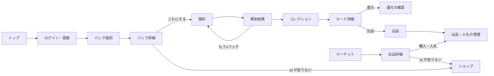

# 画面設計

> ステータス: 実装済み（設定画面と管理画面は未実装）。画面は `apps/web/src/routes/`。

[requirement.md](../requirement.md) の要件を、スマートフォンの縦画面を基準にした Web アプリ（TanStack Start）として作るための画面設計。
PC では中央に縦長のレイアウトを置き、左右は背景で埋める。

## 全体の構成

画面下のタブで4つの領域を切り替える。ヘッダーには常に pt 残高を出し、押すとショップ（pt 購入）へ進む。

| タブ         | 主な画面                             |
| ------------ | ------------------------------------ |
| パック       | パック選択、パック詳細、開封         |
| コレクション | 所持カード一覧、図鑑、カード詳細     |
| マーケット   | フリマ、オークション、出品           |
| マイページ   | 取引、残高履歴、開封履歴、設定、規約 |



## 画面一覧

| 画面             | パス                              | ログイン | 内容                                                                             |
| ---------------- | --------------------------------- | -------- | -------------------------------------------------------------------------------- |
| トップ           | `/`                               | 不要     | サービス紹介。ログイン済みなら `/packs` へ移動                                   |
| ログイン・登録   | `/login`                          | 不要     | メールアドレスとパスワード。登録後は `/packs` へ移動                             |
| パック選択       | `/packs`                          | 必要     | パックのカルーセル、無料枠の残り                                                 |
| パック詳細       | `/packs/$packSlug`                | 必要     | 排出率、注目カード、価格、開封ボタン                                             |
| 開封             | `/openings/$openingId`            | 必要     | 開封の演出。全画面                                                               |
| 開封結果         | `/openings/$openingId/result`     | 必要     | 5枚の一覧                                                                        |
| コレクション     | `/collection`                     | 必要     | 所持カードと図鑑                                                                 |
| カード詳細       | `/cards/$cardId`                  | 必要     | カードの拡大、Wikipedia の情報、還元・出品                                       |
| マーケット       | `/market`                         | 必要     | フリマ・オークションの一覧と検索                                                 |
| 出品詳細         | `/market/$listingId`              | 必要     | 購入、入札                                                                       |
| 出品             | `/market/new?userCardId=&cardId=` | 必要     | 形式と価格を決めて出品                                                           |
| 出品・入札の管理 | `/me/trades`                      | 必要     | 出品中、入札中、取引履歴                                                         |
| ショップ         | `/shop`                           | 必要     | pt 商品の一覧と購入                                                              |
| 残高履歴         | `/me/wallet`                      | 必要     | 有償・無償の内訳と増減の履歴                                                     |
| 開封履歴         | `/me/openings`                    | 必要     | 過去の開封結果                                                                   |
| マイページ       | `/me`                             | 必要     | アカウント、各履歴と規約類へのリンク、ログアウト                                 |
| 設定             | `/me/settings`                    | 必要     | 演出を短くする、サウンド（未実装）                                               |
| 規約類           | `/legal/terms` など               | 不要     | 利用規約、プライバシーポリシー、特定商取引法に基づく表記、資金決済法に基づく表示 |
| 管理: カード     | `/admin/cards`                    | 管理者   | Wikipedia からの取り込み、レアリティ確認（未実装）                               |
| 管理: パック     | `/admin/packs`                    | 管理者   | パック、排出率、注目カードの設定（未実装）                                       |

## パック選択 `/packs`

参考動画の最初の画面にあたる。パックを横に並べ、中央のパックを大きく見せる。

```txt
┌──────────────────────────────┐
│ wiki collection      ◎ 1,240pt│
├──────────────────────────────┤
│  ╭───────────────────────╮   │
│  │好きなパックを選んでください│   │
│  ╰───────────────────────╯   │
│                              │
│   ┌──┐  ┌──────┐  ┌──┐       │
│   │歴│  │ 基本 │  │宇│       │
│   │史│  │パック│  │宙│       │
│   │  │  │      │  │  │       │
│   └──┘  │ 無料 │  └──┘       │
│         └──────┘             │
│          ‾‾‾‾‾‾ 床への映り込み │
│                              │
│  無料パック 残り 28          │
│  今日の分 8/10・登録特典 20  │
├──────────────────────────────┤
│  パック コレクション 市場 自分  │
└──────────────────────────────┘
```

- 左右にスワイプ、または左右のパックをタップして中央を切り替える。
  - 中央のパックは拡大し、わずかに上下に浮かぶ。左右のパックは小さく暗めにする。
- 中央のパックをタップするとパック詳細へ進む。
- 無料パックの表示は、残りがあれば合計と内訳（今日の分・登録特典）を出し、なければ次の日本時間 0 時までの残り時間を出す。
- 背景はパステルのグラデーションにする。中央のパックの下には床への映り込みを出す。

## パック詳細 `/packs/$packSlug`

参考動画の2枚目にあたる。パックを1つだけ大きく出し、開封ボタンを置く。

```txt
┌──────────────────────────────┐
│ ←                    ◎ 1,240pt│
│                              │
│          ┌────────┐          │
│          │ 宇宙   │          │
│          │ パック │          │
│          │        │          │
│          └────────┘          │
│        ( これにする 150pt )  │
│                              │
│  出やすいカード              │
│  [ブラックホール][土星][月]  │
│                              │
│  排出率を見る ▼              │
│   4枚目 ◇◇ 70% ◇◇◇ 22% ...   │
│   5枚目 ◇◇◇ 70% ◇◇◇◇ 24% ... │
│               ( ↩ もどる )   │
└──────────────────────────────┘
```

- 開封ボタンの表示はパックと残り枠で変わる。
  - 基本パックで無料枠がある:「これにする（無料）」
  - 基本パックで無料枠がない:「あと 06:21:45」（次の日本時間 0 時まで）で押せない
  - ジャンルパック:「これにする 150pt」。pt が足りなければ「pt を購入」に変わり、ショップへ進む
- 有料パックは確認ダイアログ（「150pt を使って開封します」）を挟む。
- 押した時点でサーバーが抽選と支払いを済ませ、開封画面へ進む。
- 排出率は `pack_slot_rate` から枠ごとに計算して表示する。注目カードは `pack_featured_card` から出す。

## 開封 `/openings/$openingId`

参考動画（ポケポケの開封）の再現が目標。ヘッダーとタブを隠した全画面で、次の6段階を順に進める。
結果はサーバーで確定済みなので、演出は見せ方だけを担う。どの段階でも右上の「スキップ」で開封結果へ飛べる。

### 1. 読み込み

- 白い画面の右下に小さなローディングを出す。この間にカード画像を先読みする。
- 先読みが終わるまで次へ進まない。めくったときに画像が遅れて出るのを防ぐため。

### 2. パックの登場

```txt
┌──────────────────────────────┐
│                       スキップ│
│          ┌────────┐          │
│          │ 宇宙   │  ← 小さく │
│          │ パック │   浮かぶ  │
│          └────────┘          │
│          ▁▁▁▁▁▁▁▁ 映り込み    │
│                              │
│   パックの上を なぞって開けよう│
└──────────────────────────────┘
```

- パックが小さい状態から画面いっぱいまで拡大する（約0.6秒、ease-out）。
- 背景は白から、パックのジャンル色を混ぜた青紫のグラデーションへ変わる。光の粒がゆっくり舞う。
- 指の傾きやマウス位置に合わせてパックがわずかに傾き、表面の光沢が動く。

### 3. パックを破る

```txt
┌──────────────────────────────┐
│ ┌──────────────────────────┐ │
│ │░░░░ 宇宙パック ░░░░░░░░░░│ │
│ │━━━━━━━━━━●━━━━━━━━━━━━━━━│ │ ← 指でなぞった所まで
│ │                          │ │   白い光の線が伸びる
│ │      (パックの絵柄)       │ │
│ │                          │ │
└──────────────────────────────┘
```

- パック上端の切り取り線を、指で左から右へなぞる。
  - なぞった所まで白く光る線が伸び、端まで届いたら破れる。途中で指を離すと線は戻る。
  - 端に届いた瞬間に画面が一瞬白く光り、上部の切れ端が回転しながら画面外へ飛ぶ。軽い振動（Vibration API）と破る音を鳴らす。
- パックの下の「タップで開ける」を押すと、なぞらずに破れる。

### 4. カードが出てくる

- パック本体が下へ沈んで消え、カードの束が下からせり上がって画面中央に止まる。
- 束の上の1枚目は裏面ではなく表面で出す（参考動画と同じ）。上に「カードをタップしてめくろう」と出す。

### 5. 1枚ずつめくる

```txt
┌──────────────────────────────┐
│     カードをタップしてめくろう │
│  NEW                         │
│ ┌──────────────────────────┐ │
│ │ ブラックホール   ◇◇◇◇    │ │
│ │ ┌──────────────────────┐ │ │
│ │ │                      │ │ │
│ │ │      (記事の画像)     │ │ │
│ │ │                      │ │ │
│ │ └──────────────────────┘ │ │
│ │ 一般相対性理論によって…   │ │
│ │ 宇宙  月間 120万 閲覧     │ │
│ └──────────────────────────┘ │
│  ◇ ◇ ◇ ◇                     │
└──────────────────────────────┘
```

- タップ（または左スワイプ）で、いまのカードが左へ飛んで消え、下の1枚が見える。
- 1枚ごとに次の順で見せる。
  - カードが落ち着いた直後に、左上へ NEW バッジ（初めて手に入れたカードのとき）がポンと出る。
  - カードの下にレアリティのマークが1つずつ、少し間を置いて出る。数が多いほど期待が高まるようにする。
- レアリティごとに演出を強くする。

| レアリティ | 演出                                                                                                                             |
| ---------- | -------------------------------------------------------------------------------------------------------------------------------- |
| コモン     | 演出なし                                                                                                                         |
| アンコモン | カードの縁が一度光る                                                                                                             |
| レア       | カード表面にホログラム（虹色の光沢が傾きに合わせて流れる）。周りに光の粒                                                         |
| ダブルレア | ホログラムに加え、背景が虹色に変わる。カードが少し回転しながら現れる                                                             |
| レジェンド | 直前のカードをめくった時点で束の縁が金色に光る（予告）。めくると画面が金色に光り、カードが回転しながら拡大して出る。専用の効果音 |

- 5枚はレアリティの低い順に並べ、いちばん良いカードが最後に来るようにする。抽選のあとにサーバーで並べ替え、その順番を `user_card.slot` に保存する。
- 最後の1枚をめくったあとにもう一度タップすると、開封結果へ進む。

### 6. 開封結果

```txt
┌──────────────────────────────┐
│           開封結果           │
│ ──────────────────────────── │
│   NEW      NEW      NEW      │
│  ┌───┐   ┌───┐   ┌───┐       │
│  │   │   │   │   │   │       │
│  └───┘   └───┘   └───┘       │
│       NEW      NEW           │
│      ┌───┐   ┌───┐           │
│      │   │   │ ★ │           │
│      └───┘   └───┘           │
│                              │
│ (もう1パック)  (コレクションへ)│
│   重複カードをまとめて還元 ›  │
└──────────────────────────────┘
```

- 5枚を3枚と2枚の2段で並べる。NEW のカードにはバッジを付ける。
- カードをタップするとカード詳細へ進む。
- 「もう1パック」は同じパックで開封を続ける。開けられないときは理由（残り時間、pt 不足）を出す。
- この画面に来た時点で `pack_opening.revealedAt` を記録する。

### 実装の方針

- カードとパックの動きは CSS の 3D transform と Motion（`motion/react`）で作る。ホログラムは CSS のグラデーションと `mix-blend-mode` で作り、指やマウスの位置に合わせて光沢とカードの傾きを動かす。
- 光の粒は SVG の星を Motion で点滅させて描く。
- 破る操作はパック上端の帯に Pointer Events を付けて、左端からの位置で進み具合を出す。端の 90% まで届いたら破れる。指を離すと線は戻る。なぞるのが難しい人のために「タップで開ける」も置く。
- `prefers-reduced-motion` が有効なときは、拡大・回転を省いたフェードだけの演出にする。
- 未実装: 効果音（Web Audio）、端末の傾き（DeviceOrientation）でのホログラム、パックの3D表現（Three.js、`.claude/skills` の threejs 系スキルに従う）。

## コレクション `/collection`

```txt
┌──────────────────────────────┐
│ コレクション          ◎ 1,240pt│
│ [所持カード] [図鑑 128/2400] │
│ ジャンル▼ レアリティ▼ 並び順▼│
│ ┌───┐ ┌───┐ ┌───┐ ┌───┐      │
│ │   │ │   │ │   │ │   │      │
│ └───┘ └───┘ └───┘ └───┘      │
│  ×3    ×1    ×2  出品中1     │
│ ┌───┐ ┌───┐ ┌───┐ ┌───┐      │
│ ...                          │
│ [重複をまとめて還元]          │
└──────────────────────────────┘
```

- 所持カードタブは、同じカードを1つにまとめて枚数を出す。出品中の枚数も出す。
- 図鑑タブは、ジャンルごとに全カードを並べ、手に入れたことのないカードはシルエットで出す。ジャンルごとのコンプリート率を出す。
- 「重複をまとめて還元」は、各カードを1枚ずつ残して残りを還元する。対象と受け取る pt を確認ダイアログで出す。

## カード詳細 `/cards/$cardId`

```txt
┌──────────────────────────────┐
│ ←                    ◎ 1,240pt│
│      ┌──────────────┐        │
│      │  (カード拡大) │ ← 傾けるとホロが動く
│      └──────────────┘        │
│ ブラックホール  ◇◇◇◇ ダブルレア│
│ 宇宙 / 月間 120万 閲覧        │
│ 一般相対性理論によって予言…   │
│ Wikipedia で読む ↗           │
│ 出典: Wikipedia「ブラックホール」│
│ CC BY-SA 4.0 / 画像: NASA     │
│ ──────────────────────────── │
│ 所持 3枚（出品中 1）          │
│ (還元する 60pt)  (出品する)   │
│ マーケットの最安値 85pt ›     │
└──────────────────────────────┘
```

- 出典とライセンス表記は必ず出す。
- 還元は確認ダイアログで受け取る pt を見せてから実行する。演出として pt の数字がヘッダーの残高へ飛んでいく。
- 「出品する」は出品画面へ進む。所持中（`owned`）の枚数が 0 なら押せない。
- マーケットに同じカードの出品があれば最安値を出し、マーケットの絞り込み結果へ進めるようにする。

## マーケット `/market`

```txt
┌──────────────────────────────┐
│ マーケット            ◎ 1,240pt│
│ [フリマ] [オークション]      │
│ 🔍 カード名で検索            │
│ ジャンル▼ レアリティ▼ 並び順▼│
│ ┌────┐ ブラックホール ◇◇◇◇  │
│ │    │ 85pt                  │
│ └────┘ 出品者 taro          │
│ ┌────┐ 織田信長 ☆           │
│ │    │ 現在 420pt 入札 7件   │
│ └────┘ 残り 2時間13分        │
└──────────────────────────────┘
```

- フリマタブは価格の安い順、新着順で並べ替えられる。
- オークションタブは終了が近い順、入札数の多い順で並べ替えられる。
- 自分の出品は一覧に出すが、購入・入札のボタンは出さない。

## 出品詳細 `/market/$listingId`

- フリマ: 価格と「購入する」ボタン。確認ダイアログで支払う pt と購入後の残高を見せる。
- オークション: 現在価格、残り時間（1秒ごとに更新）、入札履歴、入札額の入力欄。
  - 入力欄の初期値は次に入札できる最低額にする。
  - 入札すると、その額が残高から押さえられることを確認ダイアログで伝える。
  - 抜かれたら押さえは戻る。
- pt が足りないときはボタンが「pt を購入」に変わり、ショップへ進む。

## 出品 `/market/new?userCardId=&cardId=`

```txt
┌──────────────────────────────┐
│ ← 出品                        │
│ ┌────┐ ブラックホール ◇◇◇◇   │
│ └────┘ 最安値 85pt / 還元 60pt│
│ 形式  (●フリマ) (○オークション)│
│ 価格  [   90 ] pt            │
│ 手数料 10%   -9pt            │
│ 受け取り      81pt           │
│ ──────────────────────────── │
│ オークションのとき            │
│ 開始価格 [ 50 ] pt           │
│ 期間 (1日) (3日) (7日)       │
│         ( 出品する )         │
└──────────────────────────────┘
```

- 同じカードの最安値と還元 pt を参考に出し、価格を決めやすくする。
- 手数料と受け取り額は入力に合わせてその場で計算する。
- 出品中のカードは還元できないことを注意書きで出す。

## 出品・入札の管理 `/me/trades`

- 出品中: 取り下げボタン。オークションは入札が入ったら取り下げられない。
- 入札中: 自分が最高額か、抜かれたかを出す。
- 取引履歴: 売れたもの、買ったもの、落札したもの。

## ショップ `/shop`

```txt
┌──────────────────────────────┐
│ ショップ                      │
│ 残高 1,240pt（有償 1,000 / 無償 240）│
│ ┌──────────────────────────┐ │
│ │ 500pt              $5    │ │
│ ├──────────────────────────┤ │
│ │ 1,000pt            $10   │ │
│ ├──────────────────────────┤ │
│ │ 5,000pt            $50   │ │
│ └──────────────────────────┘ │
│ 特定商取引法に基づく表記 ›    │
│ 資金決済法に基づく表示 ›      │
└──────────────────────────────┘
```

- 商品を選ぶと確認ダイアログを出し、購入すると残高に有償 pt が入る。
  - 決済サービスとの連携は未実装。Stripe Checkout へ移動し、Webhook で付与する形にする予定。いまはローカル開発でだけ、支払いなしで購入できる。本番では商品を押せず「現在 pt は購入できません」と出す。
- 未成年の月額上限に達している場合は購入できない旨を出す。
- 購入前に、pt は払い戻しできないことを表示する。

## 残高履歴・開封履歴

- 残高履歴 `/me/wallet`: `coin_transaction` を新しい順に、種類、増減、残高で出す。有償と無償の内訳も出す。
- 開封履歴 `/me/openings`: 日時、パック、5枚の縮小画像。演出を最後まで見ていない開封があれば「続きを見る」で開封画面へ戻れる。

## 共通の部品

- カード: 縦横比 63:88（一般的なトレーディングカードと同じ）。ジャンル色の枠、タイトル、レアリティのマーク、画像、要約、ジャンルと閲覧数。サイズ違い（一覧用・演出用・拡大用）を1つの部品で出す。
- pt 残高: ヘッダー右上。増減したときに数字がカウントアップする。
- 確認ダイアログ: pt を使う操作、カードを手放す操作は必ず確認を挟む。
